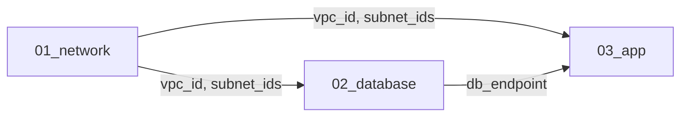

Terraform で AWS の IaC を実装するときは、設計工程から開発工程へ設計指示書（詳細設計書・パラメータシート）を渡します。この書き方次第で、実装の速さとミスの量が大きく変わります。

結論から言うと、設計指示書は **Terraform のコード構造（ディレクトリ・変数・リソース）にそのまま対応づけられる形** で書くのが最も効率的です。マネジメントコンソールの画面キャプチャを並べた Excel や、文章中心の設計書では、実装者が「この項目はどの引数のことか」を毎回調べ直すことになります。

この記事では、設計指示書に含めるべき 4 つの要素、記述のベストプラクティス、AI に実装させる場合の書き方、そして構成図を描くツールの選び方を整理します。

## 設計指示書に含めるべき 4 つの要素

実装者が迷わずコードに落とし込めるよう、設計指示書を次の 4 つのセクションに分けます。それぞれが Terraform リポジトリのどこに対応するかを図にすると次のとおりです。


### ① アーキテクチャ全体像と State 分割方針

リソース単体の設定だけでなく、**どの単位でディレクトリと State（tfstate ファイル）を分割するか** の指示が欠かせません。ここが曖昧だと、実装者ごとに分割の粒度がばらつき、後から State を移し替える羽目になります。

- **構成図**: VPC・サブネットの配置やセキュリティグループ間の通信の向きなど、AWS サービス間の依存関係が分かる図
- **ディレクトリ・State の分割ルール**: 変更頻度やライフサイクルに応じた分割（例: `01_network`、`02_database`、`03_app`）
- **別 State の値の参照方法**: `terraform_remote_state` を使うか、`data` ソースでタグや名前から引くか

たとえば `03_app` から `01_network` の VPC ID を参照する場合、`terraform_remote_state` を使うと次のようになります。

```hcl
data "terraform_remote_state" "network" {
  backend = "s3"
  config = {
    bucket = "myproj-tfstate"
    key    = "dev/01_network/terraform.tfstate"
    region = "ap-northeast-1"
  }
}

resource "aws_security_group" "app" {
  # local.name_prefix は ② の locals で定義
  name   = "${local.name_prefix}-app-sg"
  vpc_id = data.terraform_remote_state.network.outputs.vpc_id
}
```

`terraform_remote_state` は参照先の State にあるルートモジュールの outputs を読む仕組みです。参照される側が何を `output` として公開するかも設計指示書に書いておくと、ディレクトリ間の契約がはっきりします。

### ② リソース一覧と命名規則

作成するリソースの全体リストと、次の 2 種類の名前のルールを明記します。

- **論理名**: Terraform のコード上で扱う名前（リソースアドレス。例: `aws_vpc.main`）
- **物理名**: AWS 上に現れる名前（`Name` タグなど）

環境識別子は、`dev` / `stg` / `prod` を変数 `var.env` で切り替える前提のフォーマット（例: `${var.project}-${var.env}-vpc`）で指示します。

全リソースに付与する共通タグは、AWS プロバイダーの `default_tags` で一括指定できます。設計指示書にはタグのキーと値の決め方だけを書けば、実装は次の数行で済みます。

```hcl
locals {
  name_prefix = "${var.project}-${var.env}"
}

provider "aws" {
  region = "ap-northeast-1"

  default_tags {
    tags = {
      Environment = var.env
      Owner       = var.owner
      ManagedBy   = "terraform"
    }
  }
}
```

### ③ パラメータシート（`variables.tf` との対応表）

ここが最も重要なセクションです。Excel などでパラメータシートを作る場合も、**列を Terraform の実装構造に合わせます**。

| リソース種別 | Terraform 変数名 (`var.xxx`) | 型 (`type`) | dev 環境値 | prod 環境値 | 備考・制約 |
| --- | --- | --- | --- | --- | --- |
| VPC | `vpc_cidr` | `string` | `10.0.0.0/16` | `10.1.0.0/16` | ピアリング先と重複不可 |
| Subnet | `public_subnet_cidrs` | `list(string)` | `["10.0.1.0/24", "10.0.2.0/24"]` | `["10.1.1.0/24", "10.1.2.0/24"]` | AZ-a、AZ-c に配置 |
| RDS | `db_instance_class` | `string` | `db.t4g.micro` | `db.r6g.large` | prod のみ Multi-AZ を有効化 |
| RDS | `db_deletion_protection` | `bool` | `false` | `true` | 誤削除防止 |

ポイントは、**環境ごとに異なる値は変数として切り出し**、全環境で共通の固定値はリソースブロック内に直接書く（または `locals` に定義する）ように指示を分けることです。

この表はほぼ機械的に `variables.tf` と環境ごとの `.tfvars` に変換できます。「備考・制約」の列は、`validation` ブロックとしてコードに落とせるものもあります。

```hcl
# variables.tf（抜粋。public_subnet_cidrs と db_instance_class も同様に宣言する）
variable "vpc_cidr" {
  type        = string
  description = "VPC の CIDR。ピアリング先と重複不可"

  validation {
    condition     = can(cidrhost(var.vpc_cidr, 0))
    error_message = "vpc_cidr は CIDR 表記で指定してください。"
  }
}

variable "db_deletion_protection" {
  type        = bool
  description = "RDS の削除保護（誤削除防止）"
}
```

```hcl
# envs/prod.tfvars
vpc_cidr               = "10.1.0.0/16"
public_subnet_cidrs    = ["10.1.1.0/24", "10.1.2.0/24"]
db_instance_class      = "db.r6g.large"
db_deletion_protection = true
```

### ④ 機密情報・外部連携・手動作業の境界線

Terraform のコードに平文で書いてはいけないものと、Terraform の管理外にするものの線引きを明記します。

- **シークレットの渡し方**: DB パスワードや API キーの扱い。たとえば「AWS Secrets Manager で事前に手動作成し、Terraform 側では `data "aws_secretsmanager_secret"` で ARN だけを参照する」と決めておきます
- **手動作業（Bootstrap）**: Terraform の実行前後に必要な手順。たとえば次のようなもの
  - S3 バックエンド用バケットの作成
  - ACM 証明書の DNS 検証レコードの追加（DNS を Terraform 管理外で運用している場合）
  - 初回デプロイ用のダミーコンテナイメージのプッシュ

```hcl
data "aws_secretsmanager_secret" "db" {
  name = "${local.name_prefix}/db/master"
}

# アプリには ARN だけを渡し、値の取得は実行時に任せる
# 例: ECS タスク定義の secrets の valueFrom に data.aws_secretsmanager_secret.db.arn を指定
```

ARN だけを参照するのは、`aws_secretsmanager_secret_version` などでシークレットの値そのものを読み込むと、その値が tfstate に平文で残るためです。そこで設計指示書には「値を読む data ソースは使わない」まで書いておくと安全です。

## 記述における 3 つのベストプラクティス

### 1. 画面の項目名ではなく Terraform の引数名で書く

マネジメントコンソールの日本語 UI 表記（「削除保護の有効化」など）ではなく、Terraform Registry のドキュメントにある引数名（`deletion_protection = true`）をそのまま書きます。コンソールの表記は UI の改修で変わることがあります。引数名で書いておけば、日本語訳から引数を探す手間も解釈違いもなくなります。

### 2. デフォルト値のままにする項目は書かない

AWS や Terraform のデフォルト値で問題ないパラメータまで表に並べると、設計書が肥大化してメンテナンスできなくなります。「デフォルトから変更する項目だけを記載する」というルールを、設計チームと開発チームで合意しておきます。

### 3. 設計指示書をコードリポジトリに Markdown で置く

Excel や Word で管理すると、実装後のコード変更と設計書がすぐに食い違います。リポジトリ内に `docs/` ディレクトリを作り、Markdown と図で管理して、コードの Pull Request と同時に設計書も更新する運用が理想です。

## AI（LLM）に Terraform コードを生成させる場合

開発工程でエンジニアだけでなく Claude や GitHub Copilot などの AI にも実装させる場合は、設計指示書を **構造化された Markdown と、YAML / JSON のパラメータ定義** で書いておくと効果的です。設計書をそのままプロンプトに渡せるので、生成される `.tf` の精度が上がり、手戻りが減ります。

たとえば、③のパラメータシートを YAML で表すと次のようになります。

```yaml
variables:
  vpc_cidr:
    type: string
    values: { dev: "10.0.0.0/16", prod: "10.1.0.0/16" }
    constraint: ピアリング先と重複不可
  db_instance_class:
    type: string
    values: { dev: "db.t4g.micro", prod: "db.r6g.large" }
    constraint: prod のみ Multi-AZ を有効化
  db_deletion_protection:
    type: bool
    values: { dev: false, prod: true }
    constraint: 誤削除防止
```

人が読む表と AI が読む定義を別々に持つと乖離するので、YAML を正として表を生成するなど、どちらか一方を正本に決めておくのがおすすめです。

## 構成図はどのツールで描くか

設計指示書の①で必要になる構成図について、ツールの選択肢を比較します。

### 主要な構成図ツールの比較

| ツール | 記述方式 | AWS アイコン | Git での差分管理 | 向いているケース |
| --- | --- | --- | --- | --- |
| draw.io | GUI（ドラッグ＆ドロップ） | 公式アイコン完備 | △（XML で読みにくい） | 複雑なネットワーク構成、顧客への提示用 |
| Mermaid | テキスト（Markdown に埋め込み） | 簡易的 | ◎（テキスト差分） | GitHub 中心の開発、処理フローや依存関係 |
| Diagrams（Python） | コード（Python スクリプト） | 公式アイコン完備 | ◎（コード差分） | 公式アイコンの見栄えとコード管理の両立 |
| Eraser / Lucidchart | GUI・AI 生成（SaaS） | 公式アイコン完備 | ×（URL 共有ベース） | デザイン性重視、複数人での同時編集 |
| Inframap / Rover / `terraform graph` | Terraform のコード・State・plan から自動生成 | 簡易的 | ◎（コードから生成） | 実装後の答え合わせ、現状把握 |

### draw.io（diagrams.net）

draw.io は Terraform 向けの設計指示書でも十分に優秀な選択肢です。特に `.drawio.svg` や `.drawio.png` 形式で保存すると、画像の中に図のデータが埋め込まれるため、GitHub 上でのプレビュー表示と draw.io での再編集を両立できます。

ネットワーク境界（VPC、サブネット、ルートテーブル、NAT Gateway、セキュリティグループ間の通信の向き）を正確に伝えるには、自由度の高い draw.io が最も誤解を生みません。

### Mermaid（テキストベース）

GitHub や GitLab、Notion で設計書を管理しているなら、最も手軽に更新できる選択肢です。

- **メリット**: Markdown ファイルの中にコードとして直接書けるので環境構築が不要で、Pull Request で「どこが変わったか」をテキストでレビューできる
- **デメリット**:
  - AWS アイコンを使ったリッチな表現は苦手
  - VPC の中に AZ、その中に Public / Private Subnet が入る、といった入れ子の深い図はレイアウトが崩れやすい
- **向いている用途**: VPC 内の詳細な配置図ではなく、リソース間の依存関係（module の呼び出し関係）やデータフロー、シーケンス図

たとえば State 分割したディレクトリ間の参照関係なら、数行で書けます。



### Diagrams（Python による Diagram as Code）

Python のコードから AWS 公式アイコン付きの構成図（PNG / SVG）を生成するオープンソースのライブラリです。

- **メリット**: draw.io のような公式アイコンの見やすさと、コードによるバージョン管理のいいとこ取りができる。VPC やサブネットのグループを `Cluster` で記述すると、自動で整列した画像を出力してくれる
- **デメリット**: 開発環境に Python と Graphviz が必要。矢印の細かな取り回しは自動レイアウト任せになる
- **向いている用途**: 設計者もエンジニア寄りで、レイアウト調整に時間をかけずに公式アイコンを使った図を渡したい場合

`pip install diagrams` でインストールし、Graphviz も入れておきます（macOS なら `brew install graphviz`）。次のスクリプトを実行すると、カレントディレクトリに `myproj-dev.png` が出力されます。

```python
from diagrams import Cluster, Diagram
from diagrams.aws.compute import ECS
from diagrams.aws.database import RDS
from diagrams.aws.network import ALB

with Diagram("myproj-dev", show=False):
    with Cluster("VPC"):
        with Cluster("Public Subnet"):
            alb = ALB("alb")
        with Cluster("Private Subnet"):
            app = ECS("app")
            db = RDS("db")
    alb >> app >> db
```

### Eraser（AI 作図機能付きのクラウド型ツール）

近年シェアを伸ばしているクラウド型の作図ツールです。

- **メリット**: 洗練された見やすい図が作れ、独自のテキスト記法（Diagram as Code）でも GUI でも編集できる。Terraform のコードや自然言語から構成図を生成する AI 機能がある
- **デメリット**: 無料プランはファイル数や AI 生成の回数が限られ、GitHub 連携も有料プラン向けの機能になっている。チームで本格的に使うには契約が必要。外部 SaaS に構成情報をアップロードしてよいか、セキュリティポリシーの確認も要る

比較表で並べた Lucidchart も、GUI で描く SaaS という点で同じ位置づけです。

### Inframap / Rover / `terraform graph`（コードからの逆生成）

設計指示の段階ではなく、実装後のレビューや引き継ぎ向けのツールです。読み込むものはツールごとに違います。

- **Inframap**: tfstate または HCL（`.tf`）を読んで図を出力する
- **Rover**: Terraform の構成と plan を読み、ブラウザで操作できる図を表示する
- **`terraform graph`**: Terraform 標準のコマンドで、構成または plan の依存関係を DOT 形式で出力する。画像にするには Graphviz の `dot` コマンドを通す

開発チームが実装した Terraform コードが設計指示書どおりかを視覚的に確かめる「答え合わせ」として使うと効果的です。

### 使い分けの結論

- **迷ったら draw.io のままでよい**。保存形式を `.drawio.svg` にして Git リポジトリに入れておけば、開発者は GitHub 上で直接閲覧でき、修正もそのまま draw.io で開ける
- 図のメンテナンスコストを極限まで下げたい場合に限り、Mermaid か Diagrams に切り替える。依存関係やフロー図なら Mermaid、公式アイコン付きの配置図なら Diagrams
- 実装後は Inframap や Rover で逆生成した図と、設計指示書の構成図を突き合わせる

## まとめ

- 設計指示書は「全体像と State 分割」「命名規則」「パラメータシート」「機密情報と手動作業の境界」の 4 要素に分け、それぞれを Terraform のディレクトリ・`locals`・`variables.tf`・`data` ソースに対応させる
- パラメータシートの列は Terraform の変数名・型・環境ごとの値に合わせ、画面の項目名ではなく引数名で書き、デフォルトのままの項目は書かない
- 設計書は Markdown でリポジトリに置き、コードと同じ Pull Request で更新する。AI に実装させるなら YAML などの構造化データで書く
- 構成図は draw.io（`.drawio.svg`）を基本に、テキスト管理を重視するなら Mermaid や Diagrams を選ぶ
